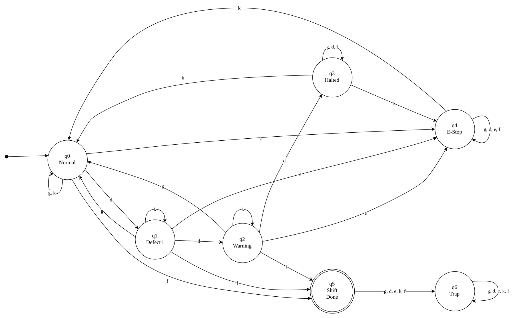
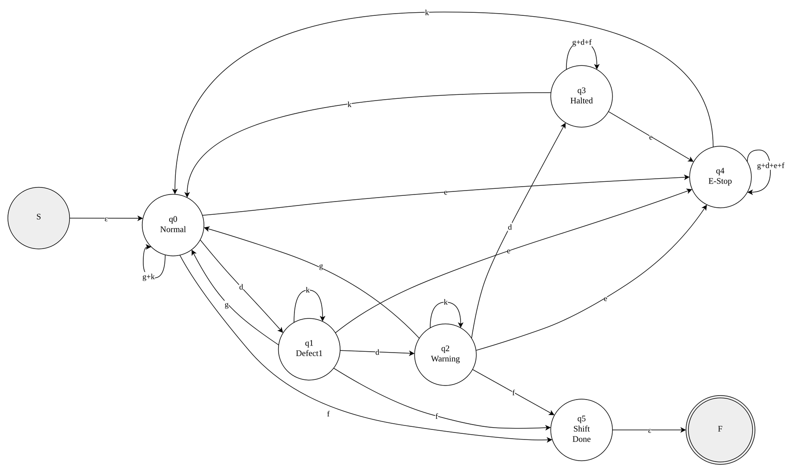
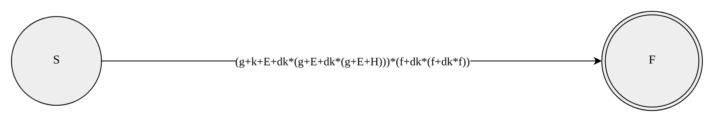

# Factory Line Quality Control System: Finite Automata Design

A deterministic finite automaton (DFA) that decides when a snack-packaging line should **warn**, **halt** or **emergency-stop**, converted into a **regular expression** by state elimination and analysed for **complexity** and **computability**.

Group assignment for the *Computing Theory* module at Asia Pacific University of Technology and Innovation (APU), 2026. The repository contains the design, the full write-up, all diagrams, and a tested Python implementation of the automaton.



---

## The problem

A potato-chip packaging line has an optical sensor that marks every sealed bag as good or defective (torn or underweight). The controller must:

1. Count **consecutive** defective bags and reset the count when a good bag passes.
2. Escalate in two stages: **warning** first, then a **halt**.
3. Allow recovery from a halt **only** through a supervisor key-switch.
4. Accept an **emergency stop** from any state, cleared only by the same supervisor reset.

## Design summary

**Input alphabet** Σ = {g, d, e, k, f}

| Symbol | Event |
|---|---|
| `g` | good bag |
| `d` | defective bag |
| `e` | emergency-stop button |
| `k` | supervisor key-switch reset |
| `f` | end of shift |

**States** (minimum required: 6)

| State | Meaning | Consecutive defects |
|---|---|---|
| q0 (start) | Normal | 0 |
| q1 | Defect1 | 1 |
| q2 | Warning (light + buzzer, line keeps running) | 2 |
| q3 | Halted | 3 |
| q4 | Emergency stop | – |
| q5 (accept) | Shift closed cleanly | – |
| q6 | Trap (events after the shift closed) | – |

A shift log is **accepted** when the shift ends while the line is running, meaning every fault raised during the shift was cleared.

**Transition function** δ : Q × Σ → Q

| State | g | d | e | k | f |
|---|---|---|---|---|---|
| → q0 | q0 | q1 | q4 | q0 | q5 |
| q1 | q0 | q2 | q4 | q1 | q5 |
| q2 | q0 | q3 | q4 | q2 | q5 |
| q3 | q3 | q3 | q4 | q0 | q3 |
| q4 | q4 | q4 | q4 | q0 | q4 |
| \* q5 | q6 | q6 | q6 | q6 | q6 |
| q6 | q6 | q6 | q6 | q6 | q6 |

## Regular expression

Derived with the state elimination method (step-by-step diagrams in [`diagrams/png`](diagrams/png), working in the [full report](docs/report.md#24-regular-expression-using-the-state-elimination-method)):

```text
E = e(g+d+e+f)*k                 emergency stop, ignored events, supervisor reset
H = d(g+d+f)*(k+E)               third defect -> halt -> recovery

RE = (g + k + E + dk*(g + E + dk*(g + E + H)))* (f + dk*(f + dk*f))
```

The expression was checked against the DFA on **all 488,281 strings of length 0–8** with identical accept/reject results. The test suite repeats that check for lengths 0–6 on every push.

| Step 1: add new start/final states | Final step: single regex edge |
|---|---|
|  |  |

## Complexity and computability

- **Time:** one table lookup per event, so the worst case is **O(n)** for a shift of *n* events and the best case (an invalid log rejected at the trap state) is **O(1)**. For an 8-hour shift at 120 bags/min (n = 57,601), the DFA needs 57,601 steps, while a naive design that re-scans the history needs about 1.66 × 10⁹.
- **Memory:** **O(1)**, consisting of a 3-bit state and a 35-entry table.
- **Computability:** the transition function is total (complete), every step is a precise lookup (mechanistic), and each state/symbol pair has exactly one successor (deterministic). The language is regular, so membership is **decidable**.

## Run it

Requires Python 3.9+.

```bash
pip install -r requirements-dev.txt
pytest -q                                          # 17 tests

PYTHONPATH=src python -m factory_qc gdgddgf dddgkgf gdegf
```

Example output:

```text
Input: gdegf
Step | Current | Input | Next
-----|---------|-------|-----
   1 | q0      |   g   | q0
   2 | q0      |   d   | q1
   3 | q1      |   e   | q4
   4 | q4      |   g   | q4
   5 | q4      |   f   | q4
Result: REJECT (final state q4)
Regular expression agrees: True
```

## Repository layout

```text
src/factory_qc/        DFA (dfa.py), regular expression (regex.py), CLI (__main__.py)
tests/                 traces from the report, requirement checks, regex-vs-DFA equivalence
diagrams/              all-diagrams.drawio (editable) and png/ exports
docs/report.md         full write-up: design, pseudocode, quintuple, state elimination, Part B
```

## Team

| Member | Contribution |
|---|---|
| Swann Paing Sett (group leader) | FA design, assumptions, design justification, example traces |
| Kayes Ahemad | Pseudocode, formal definition and transition table |
| Chen Yiming | Regular expression conversion (state elimination) |
| Sibakhe Dludlu | Complexity analysis, reflective justification |
| Aung Kaung Khant | Introduction, computability, conclusion, references, report compilation |

The Python implementation and tests in `src/` and `tests/` were added for this repository to make the design runnable. The assignment itself required pseudocode.
