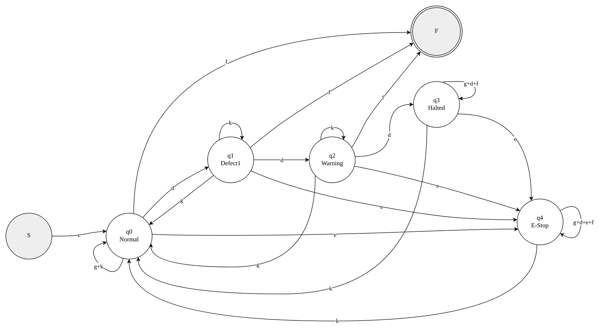
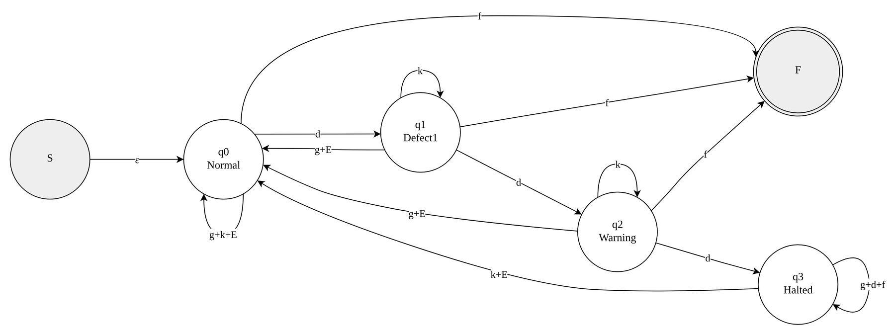
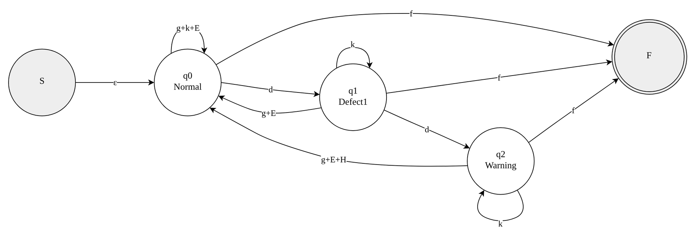
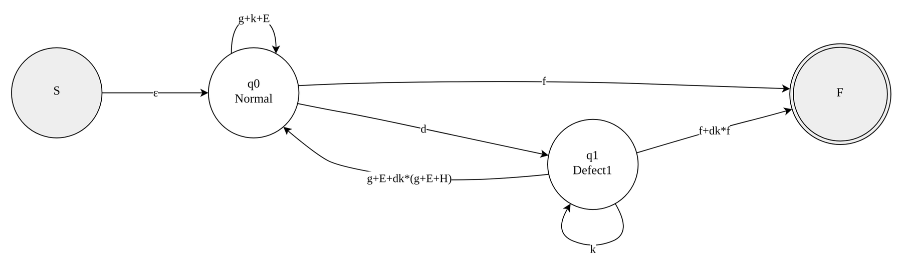
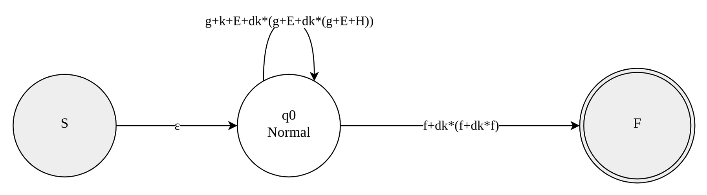

# Factory Line Quality Control System: Full Report

*Computing Theory group assignment, Asia Pacific University of Technology and Innovation (APU).*

Section numbering, tables and figures follow the submitted report. Diagrams are in [`../diagrams`](../diagrams).

## 1.0 Introduction

This report presents the group's solution for **Problem 2: Factory Line Quality Control System** from Appendix A. Nusantara Snacks Sdn. Bhd. needs an automated controller for its potato chip packaging line in Klang. An optical sensor inspects every sealed bag for torn packaging and underweight filling. The controller must ignore isolated defects, warn supervisors when defects start to repeat, halt the line when they keep repeating, and allow a separate emergency stop at any time. Only a maintenance supervisor's key-switch may bring the line back after a halt or an emergency stop.

Part A models this behaviour as a Deterministic Finite Automaton (DFA), implements it in pseudocode, defines it formally and converts it into a Regular Expression (RE) using the state elimination method. Part B analyses the complexity and computability of the design and uses those findings to recommend a real-world deployment approach. Notation and definitions follow the module lecture slides (Asia Pacific University of Technology and Innovation [APU], 2026), which are referred to below by lecture number.

## 2.0 Part A: Automata and Regular Expression

### 2.1 Finite Automata Design and Justification

#### 2.1.1 Modelling Approach

A finite automaton reads a sequence of input symbols, moves between a finite set of states, and accepts or rejects once the input ends (Sipser, 2012; Homenda & Pedrycz, 2022). The packaging line fits this model well. Every bag, button press and key-switch turn is a discrete event, and the controller only needs to remember a small amount of history: how many defective bags have occurred in a row, and whether the line is stopped. A DFA was chosen over an NFA because a safety controller must give exactly one response to each event. A nondeterministic choice such as "after a defect, either warn or do nothing" would be unacceptable on a factory floor.

One input string represents the complete sequence of events during one production shift. The string is **accepted** when the shift is closed while the line is in a running condition, meaning that every fault raised during the shift was resolved. The string is **rejected** when the shift ends with the line still halted or emergency-stopped, or when events arrive after the shift has already been closed. Table 1 defines the input alphabet.

**Table 1: Input alphabet Σ**

| Symbol | Event | Source | Available to |
|---|---|---|---|
| g | Good bag passes the sensor | Optical sensor | Automatic |
| d | Defective bag (torn packaging or underweight) | Optical sensor | Automatic |
| e | Emergency-stop button pressed | E-stop button | Any operator |
| k | Key-switch reset | Supervisor key-switch | Maintenance supervisor only |
| f | End of shift (line closed for the shift) | Shift control panel | Shift lead |

#### 2.1.2 Assumptions

The scenario leaves several behaviours open. The group made the assumptions in Table 2, each chosen so that the design stays safe, simple and faithful to the production manager's description.

**Table 2: Design assumptions and justification**

| No. | Assumption | Justification |
|---|---|---|
| AS1 | Both defect types (torn, underweight) are represented by one symbol d. | Requirement 1 counts consecutive defective bags regardless of type. Merging them is also the safer choice: a torn bag followed by an underweight bag still signals a drifting line. |
| AS2 | Warning is triggered at 2 consecutive defects; halt at 3. | The manager states that one defect is normal variance, so 2 is the first meaningful escalation point. If 1% of bags were randomly defective, two in a row would occur with probability 0.01% and three in a row 0.0001%, so 3 consecutive defects is strong evidence of miscalibration. Small thresholds also keep the automaton minimal. |
| AS3 | Each bag produces exactly one symbol, g or d. | The sensor gives one verdict per bag, so no bag is counted twice. |
| AS4 | While Halted or E-Stopped, any g, d or f input is ignored (self-loop). | The conveyor is stopped, so sensor signals are noise. Ignoring them guarantees that the line cannot restart on its own (Requirement 3). |
| AS5 | Turning the key-switch (k) while the line is running has no effect (self-loop). | Requirement 3 states the reset is not available during normal operation. It must not be usable to clear a defect count and hide a developing problem. |
| AS6 | A key-switch reset returns the line to Normal with a count of zero. | The supervisor has inspected and recalibrated the equipment, so earlier defects are no longer evidence of a current fault. |
| AS7 | Pressing e while already Halted moves the line to E-Stop. | Emergency stop has the highest priority. One supervisor reset clears both conditions (Requirement 4). |
| AS8 | The shift may close (f) from Normal, Defect1 or Warning, but not from Halted or E-Stop. | A warning is only an alert and the line is still legitimately running. A shift ending with an unresolved halt must be flagged, so those strings are rejected. |
| AS9 | Any event after f leads to a Trap state, and the empty string is rejected. | A closed shift cannot receive more events. An empty string means the shift never closed. |

#### 2.1.3 States

The design uses seven states, which exceeds the minimum of six required by the scenario. States q0, q1 and q2 hold the consecutive-defect count. Because the count is bounded at three, it can be stored in the states themselves instead of a separate counter variable. This matches the lecture point that a finite state machine has only a fixed, limited memory (Lecture 2). Table 3 describes each state.

**Table 3: State descriptions**

| State | Name | Consecutive defects | Line status | Accepting? |
|---|---|---|---|---|
| q0 (start) | Normal | 0 | Running | No |
| q1 | Defect1 | 1 | Running | No |
| q2 | Warning | 2 | Running, light and buzzer ON | No |
| q3 | Halted | 3 | Stopped (quality halt) | No |
| q4 | E-Stop | Not relevant | Stopped (emergency) | No |
| q5 | Shift Complete | Not relevant | Shift closed cleanly | Yes (final) |
| q6 | Trap | Not relevant | Invalid sequence | No |

#### 2.1.4 FA State Diagram


*Figure 1: DFA for the Factory Line Quality Control System*

Figure 1 shows the complete DFA. Every state has exactly one outgoing transition for each of the five symbols, so the automaton is complete and deterministic. Table 4 shows where each business requirement is implemented.

**Table 4: Mapping of business requirements to states and transitions**

| Requirement | Where it is implemented | Explanation |
|---|---|---|
| R1: Track consecutive defects; reset to zero on a good bag | q0 → q1 → q2 → q3 on d; q1, q2 → q0 on g; q0 → q0 on g | Each d moves one state further along the chain. Any g from a running state returns to q0, which represents a count of zero. |
| R2: At least two escalation states at different counts | q2 Warning (count 2), q3 Halted (count 3) | Warning keeps the line running (q2 still accepts g, d, f). Halted stops production: g, d and f only loop on q3. |
| R3: Recovery from halt needs a supervisor-only input | q3 → q0 on k only; k self-loops on q0, q1, q2 | k is the only way out of q3. k has no effect during normal running, so the reset is not available as a normal operation. |
| R4: E-stop from any state; cleared only by the same supervisor reset | q0, q1, q2, q3, q4 → q4 on e; q4 → q0 on k only | Every operating state has an e edge into q4. Only k leaves q4, which is the same input used in R3. |

#### 2.1.5 Design Justification

**Separate Halted and E-Stop states.** Both stop the line and both are cleared by k, so they could have been merged. They were kept apart because they have different causes: q3 is a quality halt raised automatically by the defect count, while q4 is a safety stop raised by a person. Keeping them separate lets maintenance staff know what to inspect, and the automaton records the reason for the stop. It also keeps Requirement 2 and Requirement 4 independent, so a change to one will not affect the other.

**The k self-loop on running states.** A DFA must define a transition for every state and symbol pair. The group considered sending k to the Trap state, but that would reject a whole shift because someone turned the key by mistake. A self-loop makes k harmless during normal running, which satisfies "not available during normal operation" without punishing a harmless event.

**The Trap state q6.** Once the shift is closed, the result should be final. Without q6, transitions from q5 would have to loop back into a running state, so a closed shift could be reopened. The Trap state is a standard dead state (Lecture 2 calls it the reject state qø). It guarantees that any input after f is rejected.

**Warning keeps running.** In q2 the line still accepts g, d and f exactly like q0 and q1. This follows the scenario, where a short calibration drift often corrects itself. A good bag in q2 returns to q0, which also turns the warning light off.

#### 2.1.6 Example Traces

Three input strings were traced through the DFA: two accepted and one rejected.

**Trace 1 (accepted): w₁ = g d g d d g f.** An isolated defect, then two consecutive defects that raise a warning. The warning is cleared by a good bag and the shift closes normally.

**Table 5: Trace of w₁ = gdgddgf**

| Step | Current state | Input | Next state | Meaning |
|---|---|---|---|---|
| 1 | q0 | g | q0 | Good bag, count stays 0 |
| 2 | q0 | d | q1 | First defect (isolated) |
| 3 | q1 | g | q0 | Good bag resets count (R1) |
| 4 | q0 | d | q1 | Defect, count 1 |
| 5 | q1 | d | q2 | Second consecutive defect, WARNING (R2) |
| 6 | q2 | g | q0 | Good bag resets count, warning off |
| 7 | q0 | f | q5 | Shift closed while running |

Result: the input is fully read and the final state q5 ∈ F, so w₁ is **accepted**.

**Trace 2 (accepted): w₂ = d d d g k g f.** Three consecutive defects halt the line. A spurious good-bag signal is ignored while halted, then the supervisor resets the line and production continues.

**Table 6: Trace of w₂ = dddgkgf**

| Step | Current state | Input | Next state | Meaning |
|---|---|---|---|---|
| 1 | q0 | d | q1 | Defect, count 1 |
| 2 | q1 | d | q2 | Count 2, WARNING |
| 3 | q2 | d | q3 | Count 3, line HALTED (R2) |
| 4 | q3 | g | q3 | Signal ignored; line cannot self-restart (R3) |
| 5 | q3 | k | q0 | Supervisor key-switch reset (R3) |
| 6 | q0 | g | q0 | Normal production |
| 7 | q0 | f | q5 | Shift closed while running |

Result: the final state q5 ∈ F, so w₂ is **accepted**. Step 4 shows that the good bag did not restart the line. Only k could do that.

**Trace 3 (rejected): w₃ = g d e g f.** An operator presses the emergency stop and the shift is closed without a supervisor reset.

**Table 7: Trace of w₃ = gdegf**

| Step | Current state | Input | Next state | Meaning |
|---|---|---|---|---|
| 1 | q0 | g | q0 | Good bag |
| 2 | q0 | d | q1 | Defect, count 1 |
| 3 | q1 | e | q4 | EMERGENCY STOP from a running state (R4) |
| 4 | q4 | g | q4 | Ignored while stopped |
| 5 | q4 | f | q4 | Shift cannot close cleanly while E-stopped |

Result: the input ends in q4 ∉ F, so w₃ is **rejected**. The rejection is correct because the emergency stop was never cleared by the supervisor (R4). For the same reason, the string f g is rejected: f moves to q5, and g then moves to the Trap state q6.

### 2.2 Pseudocode

The pseudocode below simulates the DFA one event at a time. It returns ACCEPT or REJECT using exactly the same rules as Figure 1. The line actions (warning, halt, restart) are side effects and do not change the decision.

**Figure 2: Pseudocode implementing the DFA**

```text
ALGORITHM FactoryLineQC(events)
// events: sequence of symbols from {g, d, e, k, f}
BEGIN
    state <- q0                         // start state: Normal, count = 0
    FOR EACH symbol IN events DO
        IF symbol NOT IN {g, d, e, k, f} THEN
            RETURN REJECT               // symbol outside the alphabet
        END IF

        IF symbol = e AND state IN {q0, q1, q2, q3, q4} THEN
            state <- q4                 // emergency stop (any state)
            STOP_LINE()
        ELSE
            CASE state OF
            q0: IF symbol = d THEN state <- q1
                ELSE IF symbol = f THEN state <- q5
                END IF                  // g, k: stay in q0
            q1: IF symbol = g THEN state <- q0
                ELSE IF symbol = d THEN state <- q2
                    RAISE_WARNING()     // light + buzzer, keep running
                ELSE IF symbol = f THEN state <- q5
                END IF                  // k: stay in q1
            q2: IF symbol = g THEN state <- q0
                    CLEAR_WARNING()
                ELSE IF symbol = d THEN state <- q3
                    HALT_LINE()
                ELSE IF symbol = f THEN state <- q5
                END IF                  // k: stay in q2
            q3: IF symbol = k THEN state <- q0
                    RESTART_LINE()
                END IF                  // g, d, f: stay in q3
            q4: IF symbol = k THEN state <- q0
                    RESTART_LINE()
                END IF                  // g, d, f: stay in q4
            q5: state <- q6             // any event after shift end
            END CASE
        END IF

        IF state = q6 THEN
            RETURN REJECT               // trap: cannot reach q5
        END IF
    END FOR

    IF state = q5 THEN RETURN ACCEPT
    ELSE RETURN REJECT
    END IF
END
```

Table 8 links each part of the pseudocode's control flow to the corresponding element of the FA.

**Table 8: Correspondence between pseudocode and FA**

| Pseudocode construct | FA element |
|---|---|
| Variable state | The current state of the DFA (one of q0 to q6) |
| state <- q0 before the loop | Start state q0 (the arrow into q0 in Figure 1) |
| FOR EACH symbol IN events | Reading the input one symbol at a time, left to right |
| Alphabet check | Σ = {g, d, e, k, f}; any other symbol is not a valid input |
| IF symbol = e branch | The e-transitions from q0, q1, q2, q3 and q4 into q4 (R4) |
| CASE branches q0 to q5 | Each row of the transition table δ (Table 9) |
| "stay" comments (no assignment) | Self-loops, e.g. g, k on q0 and g, d, f on q3 |
| IF state = q6 THEN RETURN REJECT | Trap state q6: once entered, F is unreachable |
| Final IF state = q5 | Acceptance test: is the last state in F = {q5}? |

The structure is deterministic because each branch tests one condition and assigns at most one new state. No branch is left undefined: when a symbol is not handled in a CASE branch, the state stays the same, which matches a self-loop in the diagram. The early return for q6 does not change the result because q6 never reaches q5. It only stops processing sooner, which is analysed in Part B.

### 2.3 Formal Definition (Quintuple) and State Transition Table

Following the definition used in Lecture 2, the DFA is the quintuple M = (Q, Σ, δ, q0, F), where:

- Q = {q0, q1, q2, q3, q4, q5, q6} is the finite set of states
- Σ = {g, d, e, k, f} is the input alphabet
- q0 ∈ Q is the initial state (Normal)
- F = {q5} ⊆ Q is the set of final (accepting) states
- δ : Q × Σ → Q is the transition function given in Table 9

**Table 9: State transition table for δ (→ marks the start state, * marks the final state)**

| State | g | d | e | k | f |
|---|---|---|---|---|---|
| → q0 | q0 | q1 | q4 | q0 | q5 |
| q1 | q0 | q2 | q4 | q1 | q5 |
| q2 | q0 | q3 | q4 | q2 | q5 |
| q3 | q3 | q3 | q4 | q0 | q3 |
| q4 | q4 | q4 | q4 | q0 | q4 |
| \* q5 | q6 | q6 | q6 | q6 | q6 |
| q6 | q6 | q6 | q6 | q6 | q6 |

All 35 entries (7 states × 5 symbols) are defined and each holds exactly one state, which confirms that M is a complete DFA.

### 2.4 Regular Expression using the State Elimination Method

The state elimination method from Lecture 4 is applied (see also Sipser, 2012; Maheshwari & Smid, 2014). When a state s is removed, every path p → s → r is replaced by a direct edge p → r. If an edge p → r already exists, the new label is combined with it using union (+). The new label is:

```text
R(p,r)  +  R(p,s) · R(s,s)* · R(s,r)
```

Here R(s,s) is the self-loop on s. If s has no self-loop, R(s,s)\* is ε. Parallel edges are merged with +, so g, k on q0 becomes g+k.

#### Step 0: Remove the dead (Trap) state

State q6 has no path to the final state, so no accepted string ever passes through it. Removing q6 and its edges does not change the language. After this, q5 has no outgoing edges.

#### Step 1: Apply Rules 1, 2 and 3

**Rule 1:** the initial state q0 has incoming edges (from q1, q2, q3, q4 and its own loop), so a new initial state S is added with S → q0 labelled ε. **Rule 2:** a new final state F is added with q5 → F labelled ε, so the final state has no outgoing edges. **Rule 3:** there is only one original final state (q5), so no further merging is needed. Figure 3 shows the starting diagram.


*Figure 3: Diagram after removing q6 and adding new initial state S and final state F*

#### Step 2: Eliminate q5

q5 has no self-loop. Its incoming edges are q0, q1, q2 → q5 on f, and its only outgoing edge is q5 → F on ε. Each path becomes f·ε = f:

```text
q0 → F : f          q1 → F : f          q2 → F : f
```



*Figure 4: After eliminating q5*

#### Step 3: Eliminate q4 (E-Stop)

q4 has the self-loop g+d+e+f. Its incoming edges are q0, q1, q2, q3 → q4 on e, and its only outgoing edge is q4 → q0 on k. Every path through q4 therefore has the form e(g+d+e+f)\*k: an emergency stop, any ignored events, then a supervisor reset. For readability this sub-expression is named E:

```text
E = e(g+d+e+f)*k
```

Combining E with the existing edges into q0 gives:

```text
q0 → q0 : g+k+E      q1 → q0 : g+E      q2 → q0 : g+E      q3 → q0 : k+E
```



*Figure 5: After eliminating q4 (E = e(g+d+e+f)\*k)*

#### Step 4: Eliminate q3 (Halted)

q3 has the self-loop g+d+f. Its only incoming edge is q2 → q3 on d, and its only outgoing edge is q3 → q0 on k+E. The path q2 → q3 → q0 is the third consecutive defect, followed by any ignored events, then a reset (either directly by k, or through an emergency stop and then k). It is named H:

```text
H = d(g+d+f)*(k+E)
```

```text
q2 → q0 : g + E + H
```



*Figure 6: After eliminating q3 (H = d(g+d+f)\*(k+E))*

#### Step 5: Eliminate q2 (Warning)

q2 has the self-loop k. Its incoming edge is q1 → q2 on d. Its outgoing edges are q2 → q0 on g+E+H and q2 → F on f. Two new paths are created:

```text
q1 → q0 : (g+E)  +  d k* (g+E+H)
```

```text
q1 → F  :  f  +  d k* f
```



*Figure 7: After eliminating q2*

#### Step 6: Eliminate q1 (Defect1)

q1 has the self-loop k. Its incoming edge is q0 → q1 on d. Its outgoing edges are the two labels from Step 5:

```text
q0 → q0 : (g+k+E)  +  d k* (g + E + d k* (g+E+H))
```

```text
q0 → F  :  f  +  d k* (f + d k* f)
```



*Figure 8: After eliminating q1*

#### Step 7: Eliminate q0 (Normal)

q0 has the self-loop R00 = g+k+E+dk\*(g+E+dk\*(g+E+H)), the incoming edge S → q0 on ε and the outgoing edge q0 → F on R0F = f+dk\*(f+dk\*f). The path S → F is ε·(R00)\*·R0F:


*Figure 9: Final diagram after eliminating q0*

```text
RE = ( g + k + E + dk*( g + E + dk*( g + E + H ) ) )*  ( f + dk*( f + dk*f ) )
```

Substituting E and H gives the final Regular Expression:

```text
(g + k + e(g+d+e+f)*k + dk*(g + e(g+d+e+f)*k + dk*(g + e(g+d+e+f)*k + d(g+d+f)*(k + e(g+d+e+f)*k))))* (f + dk*(f + dk*f))
```

#### Interpretation and Verification

The RE has two parts. The starred part describes every cycle that brings the line back to Normal: a good bag or an ignored key turn (g, k), an emergency stop followed by a reset (E), one or two defects followed by recovery, or three defects that lead to a halt and then a reset (H). The final part describes how the shift may close: from Normal (f), from Defect1 (dk\*f) or from Warning (dk\*dk\*f). No path closes from Halted or E-Stop, which matches assumption AS8.

The three traces confirm the RE. w₁ = gdgddgf splits into g | dg | ddg | f, all of which belong to the starred part, followed by f. w₂ = dddgkgf splits into d d [d g k] (the H path, using the k option) | g | f. w₃ = gdegf cannot be matched: after e, the RE requires a k before f can appear, so it is correctly rejected. As an extra check, the group ran a short script that compared the RE with the DFA on all 488,281 strings over Σ of length 0 to 8. Both gave the same accept or reject result for every string.

## 3.0 Part B: Complexity and Computability

### 3.1 Best-Case and Worst-Case Complexity

Let n be the length of the input string, which is the number of events recorded in one shift. The basic operation is one transition: reading a symbol and looking up δ(state, symbol) in Table 9. The table has a fixed size of 7 × 5 = 35 entries, so each lookup takes constant time, O(1), however long the shift is. The total running time T(n) is the number of transitions multiplied by this constant cost. Time complexity is expressed with the Big-O orders introduced in Lecture 13.

#### Best Case: O(1)

The best case happens when the pseudocode can stop early. The earliest point is when the input starts with f followed by any symbol, for example f g d d g .... After 2 transitions the automaton is in Trap state q6, and the pseudocode returns REJECT at once. The remaining n − 2 symbols are never read. Since the work is 2 steps for any n ≥ 2, the best case is constant, O(1).

Accepted strings never benefit from early exit. The final symbol f must be read before the automaton reaches q5, so every accepted string needs exactly n transitions. The best case for an accepted string is therefore Θ(n). This shows that the O(1) best case only applies to invalid input, where the error is detected immediately.

#### Worst Case: O(n)

In the worst case the automaton never enters q6 before the end of the input, so all n symbols are processed. This applies to every accepted string and to strings that end in q3 or q4. With n transitions at constant cost each, T(n) = c·n, which is O(n), or linear time. No symbol is ever read twice, because a DFA never moves backwards on its input.

#### Numerical Examples

Assume the line packs 120 bags per minute over an 8-hour shift. The shift then produces 120 × 60 × 8 = 57,600 bag events, plus a single f at the end, so n = 57,601. These are assumed figures used to show scale. Table 10 compares the DFA with a naive design that re-scans the whole history after every bag to count the latest run of defects. That design needs about 1 + 2 + ... + n = n(n+1)/2 comparisons, which is O(n²).

**Table 10: Number of steps for different input sizes**

| Input size n | Example | DFA best case (early reject) | DFA worst case | Naive re-scan, n(n+1)/2 |
|---|---|---|---|---|
| 5 | Trace 3: gdegf | 2 | 5 | 15 |
| 7 | Trace 1: gdgddgf | 2 | 7 | 28 |
| 1,000 | Short test run | 2 | 1,000 | 500,500 |
| 57,601 | One 8-hour shift | 2 | 57,601 | about 1.66 × 10⁹ |
| 1,000,000 | About 17 shifts | 2 | 1,000,000 | about 5.0 × 10¹¹ |

For a full shift, the DFA performs 57,601 steps while the naive approach needs about 1.66 billion. Even if each DFA step took 1 microsecond, the whole shift would be processed in about 0.06 seconds of total computation. More importantly, the response to each new bag is constant: when the third consecutive defect arrives, the halt decision is made in one step, regardless of how many bags came before. This bounded reaction time is what a real-time line controller needs.

#### Space Complexity

The DFA only stores the current state and the fixed table. Seven states fit in 3 bits (2³ = 8), and the table has 35 entries. Memory use is O(1) and does not grow with n. A design that kept the full bag history would need O(n) memory, about 57,600 records per shift.

Because the problem is solved in linear time on a deterministic machine, it belongs to the class P of tractable problems (Lecture 13). It is far from the intractable NP-complete problems such as job scheduling, so no approximation or heuristic method is needed.

### 3.2 Computability

Computability asks whether a problem can be solved by an algorithm at all. Lecture 14 states that a computation must be **complete** (cover all cases), **mechanistic** (precise) and **deterministic** (the same input always leads to the same result). A Turing machine that has these properties and halts on every input is a decider, and by the Church–Turing thesis it captures what any algorithm can compute (Sipser, 2012). The design is assessed against each criterion below.

#### Completeness

The transition function δ is total: all 35 combinations of state and symbol in Table 9 are defined. Every string in Σ\*, including unusual ones, therefore has exactly one path through the automaton and a definite answer. Some examples:

- A good-bag signal while the line is halted (q3, g) is defined: it loops on q3.
- A key turn during normal running (q1, k) is defined: it loops on q1.
- An event after the shift has closed (q5, d) is defined: it goes to q6.
- The empty string ε is defined: the automaton stays in q0, which is not final, so it is rejected.

Symbols outside Σ, such as a corrupted sensor code, are rejected by the alphabet check in the pseudocode. The computation also always terminates. The machine performs exactly one step per symbol and the input is finite, so it halts after at most n steps and can never loop forever. This termination guarantee is what separates a complete computation from one that only works for some inputs.

#### Mechanistic

Each step is a precise lookup in a table, with no human judgement or interpretation. The production manager's vague concern, "is the line going wrong?", is replaced by an exact rule: three consecutive d symbols move the automaton to q3. Two different operators, or two different PLCs, applying the rules to the same input will produce the same steps. Lecture 14 contrasts this with questions too vague for an algorithm, such as "How big is the universe?". The QC problem becomes computable only because the requirements were turned into concrete symbols, thresholds and transitions.

#### Deterministic

M is a DFA: δ maps each (state, symbol) pair to exactly one next state, and there are no ε-transitions. For example, the input dddkgf will always follow q0 → q1 → q2 → q3 → q0 → q0 → q5 and be accepted, every time it is run. By contrast, an NFA version might allow (q2, d) to move to either q3 or q2. That would accept the same string by one path and halt the line by another, which is unacceptable for safety even though NFAs and DFAs recognise the same class of languages (Lecture 3). Determinism also makes faults reproducible. An incident log replayed through the automaton will reproduce exactly the decision taken on the factory floor.

#### Decidability and the Chomsky Hierarchy

Section 2.4 produced an RE for L(M), so the language is regular. The membership question "is this shift log in L(M)?" is therefore **decidable**. A Turing machine can simulate M step by step and is guaranteed to halt with yes or no after n moves. The problem is not merely semi-decidable, where only yes-answers are guaranteed. It is also nowhere near the undecidable problems in Lecture 14, such as the Halting Problem or Wang tiling, where no algorithm can always give an answer.

The design also uses the weakest machine that is enough for the job. The defect count is bounded (it never needs to exceed 3), so a finite set of states can hold it, and no stack (PDA) or tape (Turing machine) is needed. If the requirement had been unbounded, for example "halt when the total number of defects exceeds the total number of good bags", the language would resemble aⁿbⁿ. The pumping lemma shows that such a language is not regular (Lecture 4), so it would need a more powerful model (Hopcroft et al., 2007).

One limit should be stated clearly. Computability guarantees that the automaton always gives the correct answer for its input. It cannot guarantee that the input is true. If the optical sensor misclassifies a bag, the DFA will process the wrong symbol correctly. Sensor accuracy is a physical engineering issue outside the scope of the model.

### 3.3 Reflective Justification

The group compared three ways to deploy the solution. Table 11 summarises them using the results from Sections 3.1 and 3.2.

**Table 11: Comparison of deployment approaches**

| Criterion | Option 1: Table-driven DFA on the line PLC | Option 2: Hard-coded if/else logic | Option 3: History-based server or cloud software |
|---|---|---|---|
| Time per bag | O(1), one table lookup | O(1) | O(n) or worse if history is re-scanned |
| Memory | O(1): 3-bit state and 35-entry table | O(1) | O(n): grows with every bag |
| Complete / deterministic | Yes, all 35 entries can be tested exhaustively | Yes in principle, but gaps are hard to see in nested branches | Depends on network timing and software; harder to prove |
| Cost | Low: runs on the existing PLC; no server or licence | Low | Higher: server, network, storage and support |
| Risk | Low: no network dependency; bounded reaction time | Medium: easy to introduce a missed branch when editing | Higher: network delay or outage could postpone a halt |
| Maintainability | High: thresholds are data in the table | Low: every change edits control flow | Medium: flexible, but more components to maintain |

**Recommendation.** The group recommends **Option 1, a table-driven DFA running on the line's PLC**, with a separate history logger (a reduced form of Option 3) used only for offline reporting. Correctness alone does not decide this, because all three options could be written to give the right answers. The choice rests on cost, risk and maintainability, as discussed below.

**Cost.** Section 3.1 showed that the DFA needs O(1) time per bag and O(1) memory: 3 bits of state and a 35-entry table. That fits on the programmable logic controller (PLC) that already runs the conveyor, so no new hardware, server or cloud subscription is needed. Option 3 grows linearly in memory, by about 57,600 records per shift, and would need a server and storage that the decision itself does not require. State machines can also be written in standard PLC languages, such as Sequential Function Chart or Structured Text in IEC 61131-3 (International Electrotechnical Commission [IEC], 2013), so the factory's existing engineers can support it.

**Risk.** The main risk on a packaging line is a late or missed halt that lets a batch of defective stock through. The constant reaction time shown in Section 3.1 means the halt decision is taken on the same scan as the third defect, with no network in the path. The completeness and determinism shown in Section 3.2 lower the risk further. Since δ is total and has only 35 entries, a test engineer can check every transition before commissioning, which is not possible for an open-ended history analysis. Determinism means any incident can be replayed and explained. The group also notes that the software emergency stop in this model should not be the only one. Emergency stop functions are normally designed according to ISO 13850 (International Organization for Standardization [ISO], 2015) and are usually hard-wired to cut power independently. The DFA's e input should record and mirror that hardware stop, not replace it.

A remaining risk is a wrong threshold. If the threshold is too low, nuisance halts reduce output. If it is too high, more defective bags are produced before the line stops. This is why Option 1 is preferred over Option 2.

**Maintainability.** In a table-driven DFA, the thresholds are data. If the factory later wants to warn at 3 defects and halt at 5, the engineer adds count states and rows to the table. The general pattern is h + 4 states for a halt threshold of h (count states 0 to h−1, Halted, E-Stop, Shift Complete and Trap). The per-bag cost stays O(1), and the new table remains small enough to test completely, so the computability properties from Section 3.2 still hold. In Option 2 the same change means editing nested branches. That is where undefined cases tend to appear, which would break the completeness argument.

**Trade-off accepted.** The DFA's limited memory is also its main restriction. A rule such as "5 defects in any window of 20 bags" would need a state for every possible pattern of the last 20 bags, up to 2²⁰ (about one million) states, which is impractical. Such trend analysis is the job of the offline logger. That component is not safety-critical, so its O(n) storage and network dependency are acceptable there. The group therefore keeps real-time decisions in the simple, provably complete DFA, and uses the heavier software only for reporting, which does not affect safety.

## 4.0 Conclusion

The group designed a seven-state DFA that satisfies all four business requirements of the Factory Line Quality Control System. The design was verified by traces, a pseudocode implementation, a formal quintuple and a Regular Expression derived by state elimination. The analysis shows that the solution runs in linear time with constant memory and is complete, mechanistic, deterministic and decidable. On that basis, a table-driven DFA on the existing PLC is the most cost-effective, lowest-risk and most maintainable way to deploy it.

## References

- Asia Pacific University of Technology and Innovation. (2026). *Computing theory* [Lecture slides, Lectures 2, 3, 4, 13 and 14]. Moodle.
- Homenda, W., & Pedrycz, W. (2022). *Automata theory and formal languages*. De Gruyter.
- Hopcroft, J. E., Motwani, R., & Ullman, J. D. (2007). *Introduction to automata theory, languages, and computation* (3rd ed.). Pearson Addison-Wesley.
- International Electrotechnical Commission. (2013). *Programmable controllers – Part 3: Programming languages* (IEC Standard No. 61131-3:2013). https://webstore.iec.ch/publication/4552
- International Organization for Standardization. (2015). *Safety of machinery — Emergency stop function — Principles for design* (ISO Standard No. 13850:2015).
- Maheshwari, A., & Smid, M. (2014). *Introduction to theory of computation*. Carleton University. http://cglab.ca/~michiel/TheoryOfComputation/TheoryOfComputation.pdf
- Sipser, M. (2012). *Introduction to the theory of computation* (3rd ed.). Course Technology.
